# Manual de usuario: Mesa de ayuda

Guía paso a paso para quien usa la mesa de ayuda por primera vez. Está escrita para probarla de punta a punta: primero la prepara un administrador, luego una persona levanta una solicitud, varias áreas la atienden y al final se ven los resultados en las métricas.

Todas las pantallas de este manual son de la aplicación real, con datos de ejemplo.

## Contenido

1. [Lo que la hace diferente](#1-lo-que-la-hace-diferente)
2. [Antes de empezar](#2-antes-de-empezar)
3. [Administrador: preparar la mesa de ayuda](#3-administrador-preparar-la-mesa-de-ayuda)
4. [Solicitante: pedir ayuda y darle seguimiento](#4-solicitante-pedir-ayuda-y-darle-seguimiento)
5. [Agente: atender desde la bandeja](#5-agente-atender-desde-la-bandeja)
6. [Escalamiento en cadena entre áreas](#6-escalamiento-en-cadena-entre-áreas)
7. [Tiempos de atención (SLA) y semáforo](#7-tiempos-de-atención-sla-y-semáforo)
8. [Resolver, encuesta y cierre automático](#8-resolver-encuesta-y-cierre-automático)
9. [Correo electrónico](#9-correo-electrónico)
10. [Métricas](#10-métricas)
11. [Desde el celular](#11-desde-el-celular)
12. [Guion de prueba en 15 minutos](#12-guion-de-prueba-en-15-minutos)
13. [Preguntas frecuentes](#13-preguntas-frecuentes)

---

## 1. Lo que la hace diferente

La mayoría de las herramientas de mesa de ayuda nacieron para equipos técnicos: muchos campos, flujos que hay que configurar y un vocabulario ("issue", "workflow", "assignee") que confunde a quien solo quiere que le ayuden. Esta mesa de ayuda está pensada al revés: **que cualquier persona levante una solicitud en menos de un minuto** y que **las áreas se pasen el trabajo entre ellas sin perder el hilo**.

| | Qué significa en el día a día |
| --- | --- |
| ⭐ **Pedir ayuda en dos pasos** | El solicitante elige *con quién necesita ayuda* y cuenta qué pasa con sus palabras. No hay formularios con campos obligatorios, categorías ni prioridades que adivinar; el título se toma solo de la descripción. |
| ⭐ **Escalamiento en cadena con un solo ticket** | Un mismo ticket puede pasar de Customer Happiness a Finanzas, de Finanzas a TI y de TI a Desarrollo. No se crean tickets duplicados ni "vinculados": todos trabajan sobre el mismo folio y la misma conversación. |
| ⭐ **"Resolver mi parte" o "Resolver todo"** | Cada área puede cerrar solo su parte (el ticket regresa a quien se lo pasó, con lo que encontró) o resolverlo para toda la cadena. |
| ⭐ **SLA por área (por tramo)** | Cada área que toca el ticket tiene su propio reloj. Así se ve *en qué parte de la cadena* se atora una solicitud, en lugar de un solo reloj que no dice a quién reclamarle. |
| ⭐ **Relojes justos** | Solo cuentan horas hábiles y no cuentan los días festivos. El reloj se detiene mientras se espera al solicitante y, para el área que escaló, mientras la otra área trabaja. |
| ⭐ **Lenguaje claro para el solicitante** | Ve estados que entiende (Nueva, En atención, Esperando tu respuesta, Resuelta, Cerrada). No ve la cadena interna ni las notas internas. |
| ⭐ **Notas internas con alcance** | Una nota puede ser para todas las áreas del ticket o *solo para mi área*. |
| ⭐ **Encuesta sin contraseña** | Al resolver, el solicitante califica de 1 a 5 estrellas desde la aplicación o desde el enlace del correo, sin iniciar sesión. |
| ⭐ **Cierre automático en días hábiles** | Si el solicitante no contesta, la solicitud resuelta se cierra sola a los 3 días hábiles. Si responde antes, se reabre. |
| ⭐ **Métricas listas desde el primer día** | Cumplimiento de SLA, tiempos típicos, satisfacción y hacia dónde se mueven los tickets entre áreas, sin armar reportes. |
| ⭐ **Instalación sencilla y sin costo por agente** | Un solo `docker compose up` con PostgreSQL. Es software libre (AGPL v3): no hay licencias por usuario. |
| ⭐ **Funciona con tu correo** | Microsoft 365 o cualquier servidor IMAP/SMTP: los correos al buzón de ayuda crean tickets y los avisos salen solos. |

---

## 2. Antes de empezar

### 2.1 Los cuatro papeles

| Papel | Quién es | Qué ve en el menú |
| --- | --- | --- |
| **Solicitante** | Cualquier persona que necesita ayuda. Es el papel de todos por defecto. | Nueva solicitud, Mis solicitudes |
| **Agente** | Alguien que pertenece a una o más áreas (Finanzas, TI, …). | Lo anterior + Bandeja y Métricas de sus áreas |
| **Supervisor** | Ve y actúa en *todas* las áreas. | Lo anterior, para todas las áreas |
| **Administrador** | Configura la herramienta. | Lo anterior + Usuarios, Áreas y SLA |

Un agente también puede levantar solicitudes para sí mismo: por eso todos ven "Nueva solicitud".

### 2.2 Cómo levantarla para probarla

Con Docker (lo más sencillo):

```bash
cp .env.example .env      # cambia contraseñas y el correo del administrador
docker compose up -d --build
```

Abre `http://localhost:8080` y entra con el `ADMIN_EMAIL` y `ADMIN_PASSWORD` que pusiste en `.env`.

En modo desarrollo (ver el [README](../README.md#desarrollo-local)) la aplicación queda en `http://localhost:5173` y el administrador de prueba es `admin@helpdesk.local` / `CambiaEsto123`.

### 2.3 El ejemplo que usamos en este manual

| Persona | Papel | Área |
| --- | --- | --- |
| Administrador | Administrador | |
| Laura Méndez | Agente | Customer Happiness |
| Carlos Ruiz | Agente | Finanzas |
| Diego Soto | Agente | TI y Desarrollo |
| Paola Vega | Supervisora | Todas |
| Ana Torres | Solicitante | |

---

## 3. Administrador: preparar la mesa de ayuda

### 3.1 Entrar

Abre la aplicación, escribe tu correo y contraseña y da clic en **Entrar**. Si tu empresa activó Microsoft 365, también verás el botón **Entrar con Microsoft 365**.

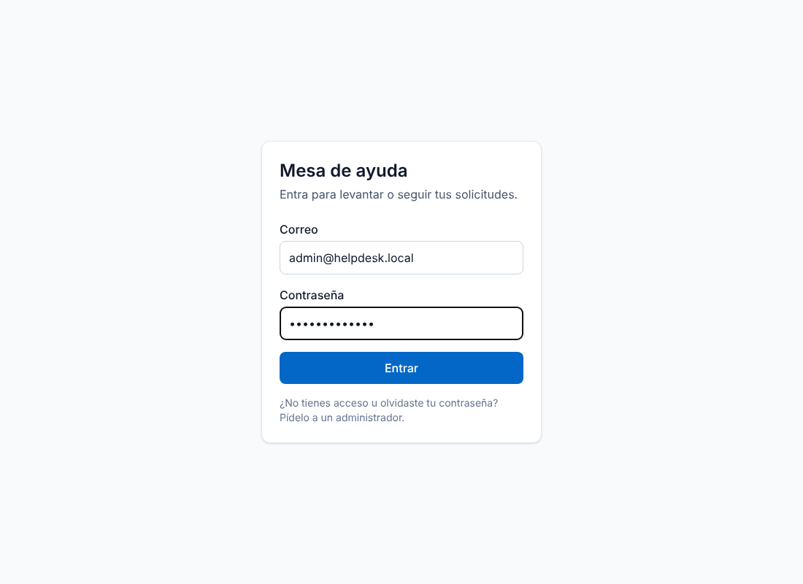

### 3.2 Crear las áreas

Las áreas son los equipos que atienden: Customer Happiness, Finanzas, TI, etc. Son lo primero que ve el solicitante, así que usa nombres y descripciones que cualquiera entienda.

1. En el menú, entra a **Áreas** y da clic en **Nueva área**.
2. Escribe el **nombre** y una **descripción** corta de lo que atiende (por ejemplo "Facturas, pagos y reembolsos").
3. Deja marcada la casilla de recibir solicitudes si cualquier persona puede pedirle ayuda directamente. Desmárcala para áreas que **solo reciben tickets escalados** por otras áreas, como Desarrollo.
4. Da clic en **Guardar**.

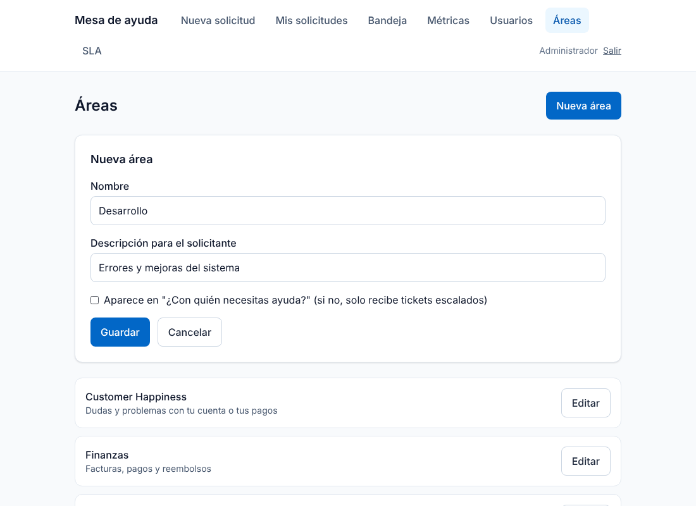

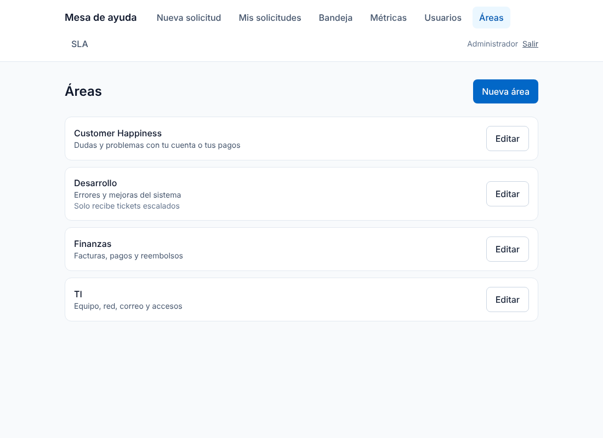

> 💡 **Diferenciador:** un área como Desarrollo no aparece para el solicitante, pero sí para los agentes cuando necesitan escalarle algo. El solicitante nunca tiene que saber a qué equipo técnico le toca.

### 3.3 Dar de alta a las personas

1. Entra a **Usuarios** y da clic en **Nuevo usuario**.
2. Escribe su **correo** y su **nombre**.
3. En **Áreas que atiende**, marca las áreas de los agentes. Déjalo vacío si la persona solo va a levantar solicitudes.
4. En **Permisos adicionales** puedes hacerla **Administrador** o **Supervisor**.
5. Da clic en **Guardar**.

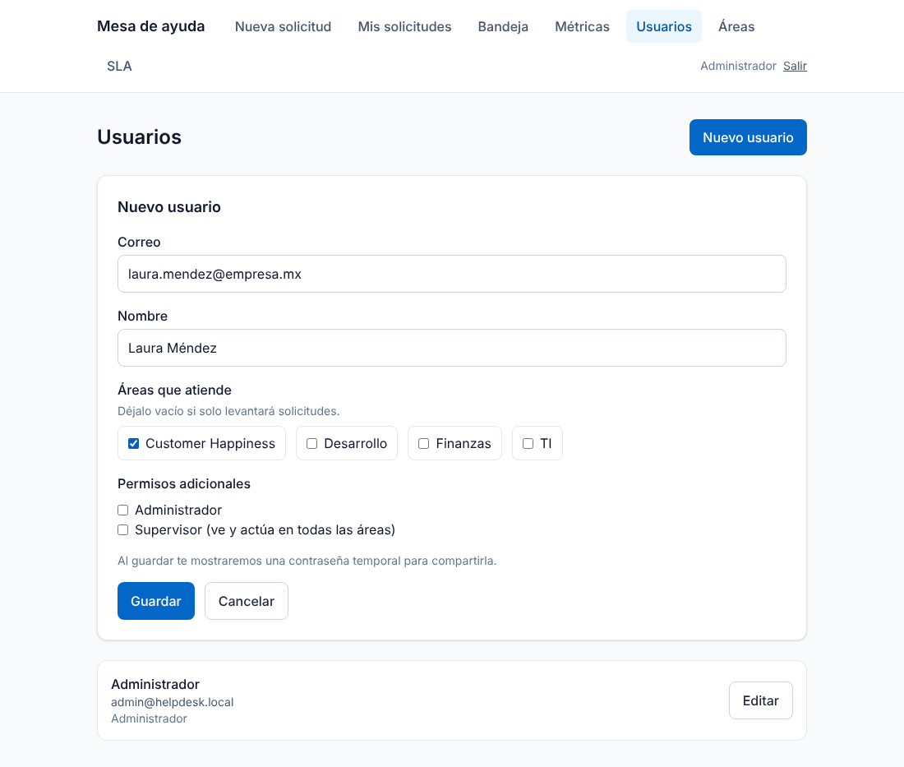

Al guardar aparece una **contraseña temporal**. Compártela con la persona por un medio seguro: no se vuelve a mostrar.

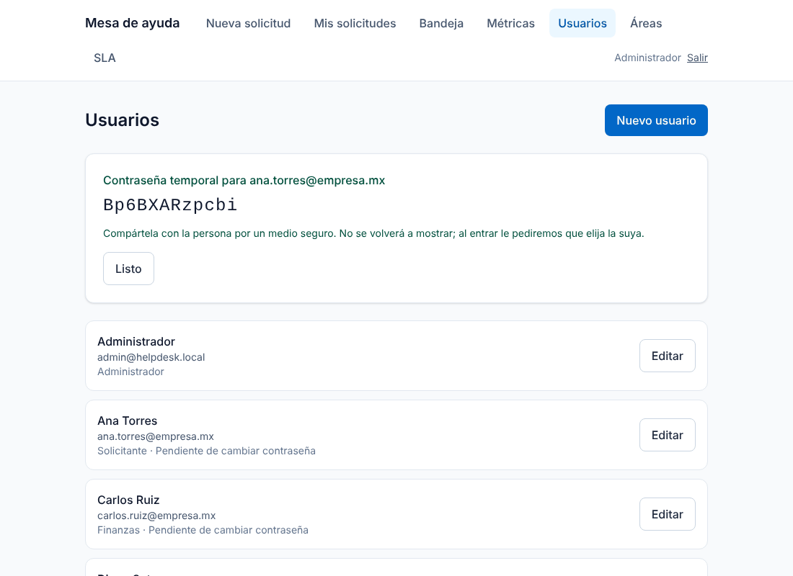

En la lista ves el papel de cada quien, si ya cambió su contraseña y si entra con Microsoft 365. Con **Editar** puedes cambiar sus áreas, desactivar la cuenta o generar otra contraseña temporal (por ejemplo, si la olvidó).

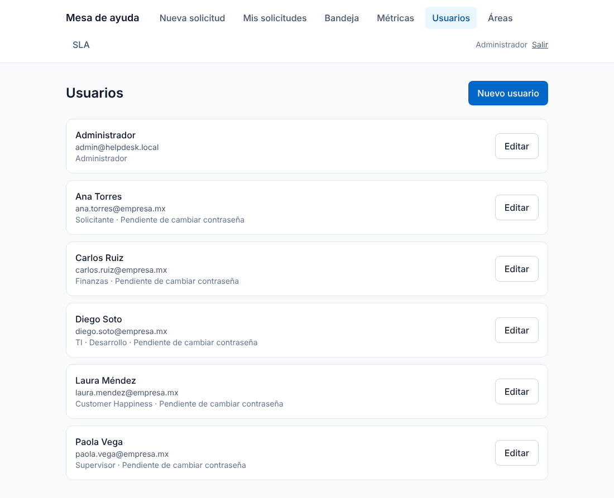

### 3.4 Primer ingreso de cada persona

La primera vez que alguien entra con su contraseña temporal, la aplicación le pide elegir la suya antes de hacer cualquier otra cosa.

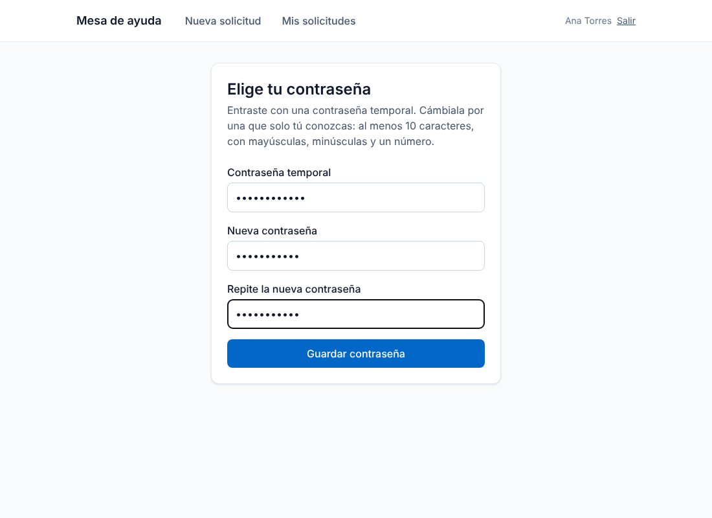

> Si la empresa usa Microsoft 365, la persona puede entrar con su cuenta de trabajo. Si ya existe un usuario con ese correo, se vincula y conserva sus áreas y permisos.

### 3.5 Ajustar los tiempos de atención

En **SLA** se definen los tiempos de primera respuesta y de resolución por prioridad, el horario laboral y los días festivos. Al instalar ya vienen tiempos iniciales razonables; lo explicamos a detalle en la [sección 7](#7-tiempos-de-atención-sla-y-semáforo).

---

## 4. Solicitante: pedir ayuda y darle seguimiento

### 4.1 Paso 1: elegir con quién necesitas ayuda

Al entrar, la primera pantalla pregunta **¿Con quién necesitas ayuda?** Da clic en la tarjeta del área.

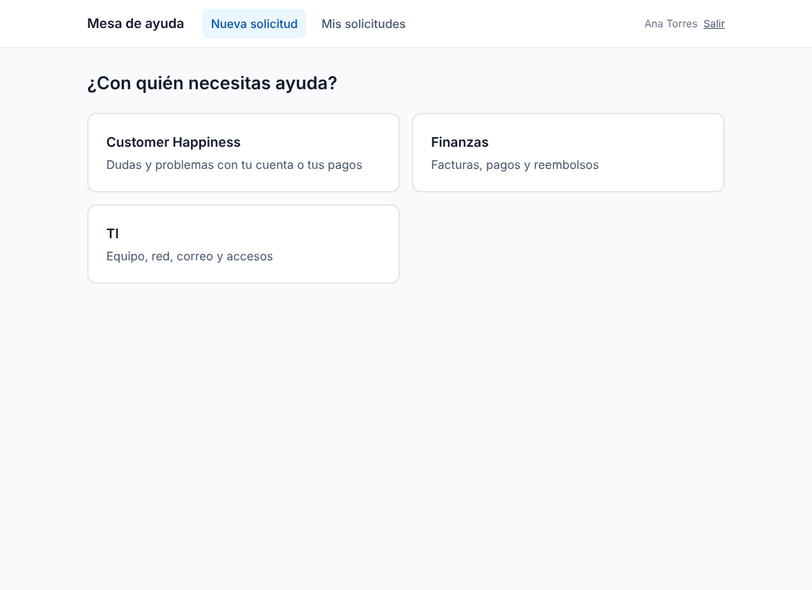

### 4.2 Paso 2: contar qué pasa

1. Escribe con tus palabras qué intentabas hacer, qué pasó y desde cuándo.
2. Si tienes una captura de pantalla o un documento, da clic en **Adjuntar archivos** (hasta 5 archivos de 10 MB cada uno).
3. Da clic en **Enviar solicitud**.

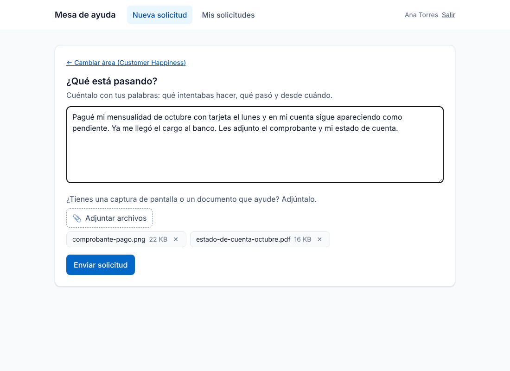

Eso es todo. No hay que elegir categoría, prioridad ni tipo de ticket: de eso se encarga el agente.

> 💡 **Diferenciador:** dos pasos y un cuadro de texto. Es la diferencia entre que la gente use la mesa de ayuda o que siga mandando mensajes por WhatsApp.

### 4.3 Tu solicitud

Al enviarla ves tu solicitud con su **folio** (#12 en el ejemplo), su estado y tus adjuntos. Las imágenes se ven en miniatura; los demás archivos se descargan con un clic. Si tienes el correo configurado, también te llega un aviso de "Recibimos tu solicitud".

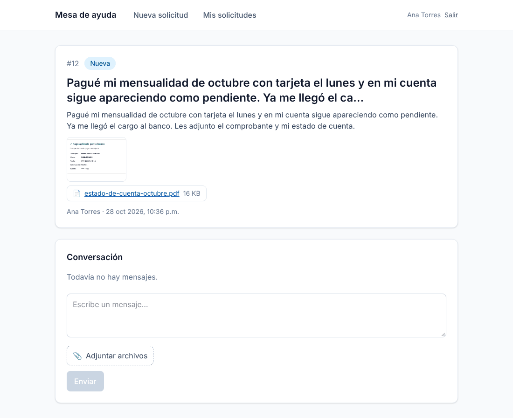

### 4.4 Seguir tus solicitudes

En **Mis solicitudes** ves todas las que has levantado, con su estado y la última actualización.

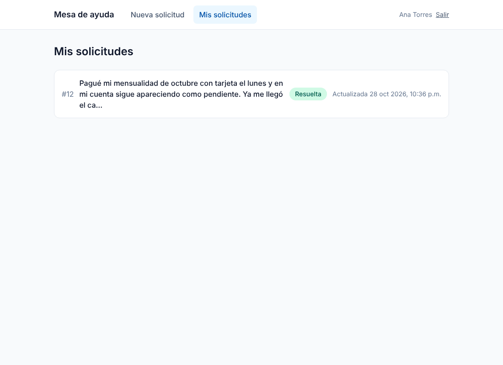

Los estados están en lenguaje claro:

| Estado | Qué significa para ti |
| --- | --- |
| **Nueva** | La recibimos y todavía nadie la ha tomado. |
| **En atención** | Alguien la está trabajando. |
| **Esperando tu respuesta** | Te pedimos un dato; contesta para que sigamos. |
| **Resuelta** | Creemos que ya quedó. Confírmalo o dinos si sigue pasando. |
| **Cerrada** | Terminó. Si vuelve a pasar, levanta una nueva. |

Para agregar información, escribe en la caja de **Conversación** (también puedes adjuntar archivos) y da clic en **Enviar**.

> El solicitante **no ve** qué áreas internas participan ni las notas internas. Ve solo las respuestas que le escriben a él.

---

## 5. Agente: atender desde la bandeja

### 5.1 La bandeja

En **Bandeja** el agente ve lo que tienen pendiente sus áreas, **ordenado por lo más próximo a vencer**. Cada tarjeta muestra el folio, el título, la prioridad, el estado y un **semáforo** con el tiempo que le queda (ver [sección 7](#7-tiempos-de-atención-sla-y-semáforo)).

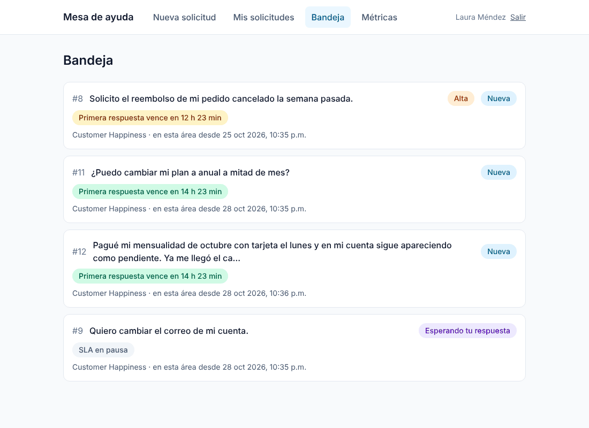

### 5.2 Abrir y trabajar un ticket

Al abrir un ticket, el agente ve tres bloques:

1. **La solicitud**, con su descripción y adjuntos.
2. **Áreas que participan**: qué áreas están en la cadena, en qué va cada una y su semáforo. Aquí están las acciones: prioridad, esperar al solicitante, escalar y resolver.
3. **Conversación**, con las respuestas y las notas internas.

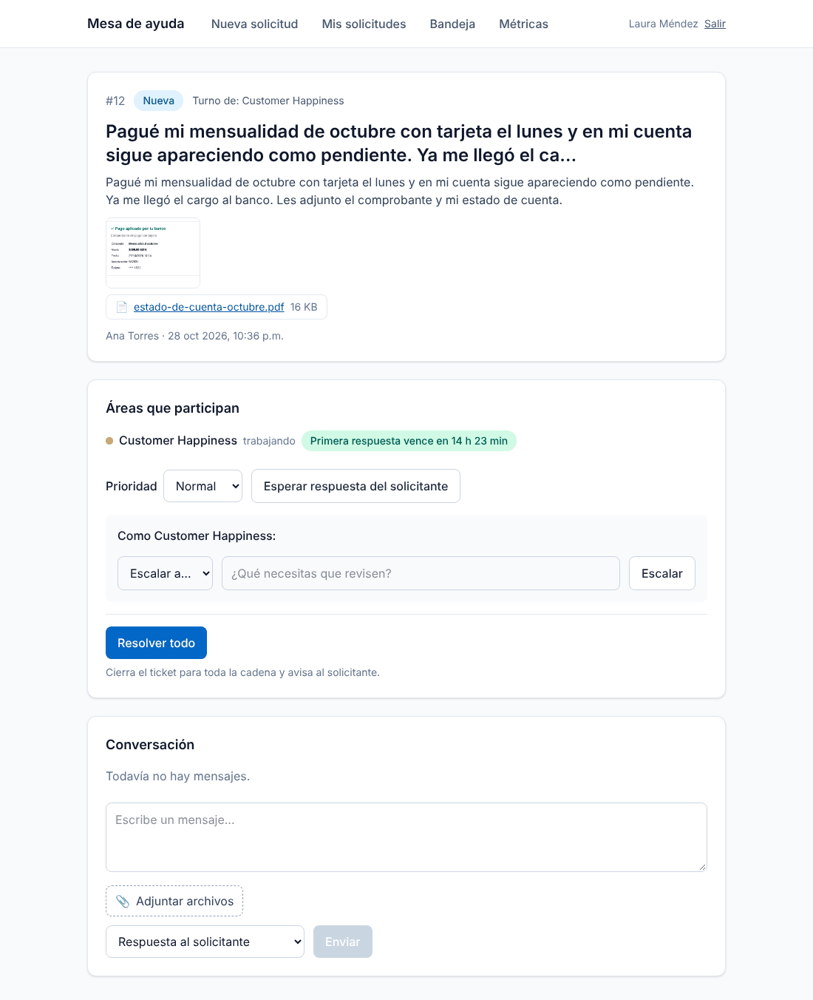

### 5.3 Cambiar la prioridad

Usa la lista **Prioridad** (Urgente, Alta, Normal, Baja). La prioridad define los tiempos de atención del SLA; al cambiarla, se recalculan.

### 5.4 Responder o dejar una nota interna

Escribe en la caja de la conversación y, antes de **Enviar**, elige a quién va dirigido:

| Opción | Quién lo ve |
| --- | --- |
| **Respuesta al solicitante** | El solicitante (y le llega por correo). |
| **Nota interna (todas las áreas)** | Todas las áreas que participan en el ticket. |
| **Nota interna (solo mi área)** | Solo los compañeros de tu área. |

Las notas internas se ven con fondo amarillo y la etiqueta "Nota interna". **Nunca** salen por correo ni las ve el solicitante.

### 5.5 Esperar respuesta del solicitante

Si necesitas un dato del solicitante, pregúntale y da clic en **Esperar respuesta del solicitante**. El estado cambia a "Esperando tu respuesta" y **el reloj del SLA se pausa**. En cuanto el solicitante contesta, el ticket regresa a "En atención" y el reloj sigue.

---

## 6. Escalamiento en cadena entre áreas

Este es el corazón de la herramienta. Sigamos el ejemplo de Ana, que pagó su mensualidad y le sigue apareciendo como pendiente.

### 6.1 Escalar a otra área

Laura (Customer Happiness) le contesta a Ana y necesita que Finanzas confirme el pago:

1. En **Como Customer Happiness**, elige el área en **Escalar a…** (Finanzas).
2. Escribe **qué necesitas que revisen**.
3. Da clic en **Escalar**.

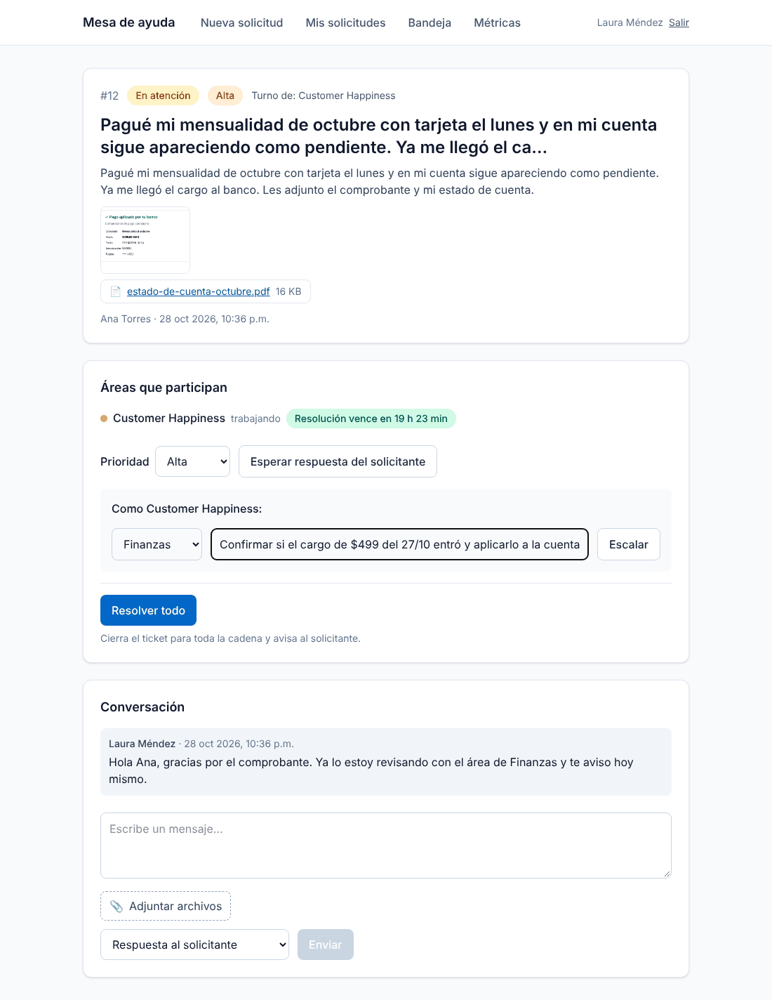

El ticket **no se duplica**: sigue siendo el #12, con la misma conversación. Ahora le toca a Finanzas ("Turno de: Finanzas") y Customer Happiness queda "esperando a otra área", con su reloj en pausa.

### 6.2 La otra área lo recibe

Carlos (Finanzas) ve el ticket en su bandeja, con el motivo por el que se lo escalaron.

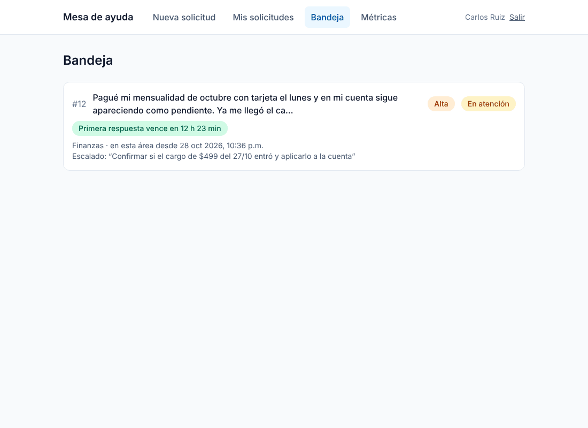

### 6.3 Resolver mi parte

Carlos revisa, deja una nota interna para las áreas y escribe en **¿Qué encontraste?** lo que hizo. Luego da clic en **Resolver mi parte**.

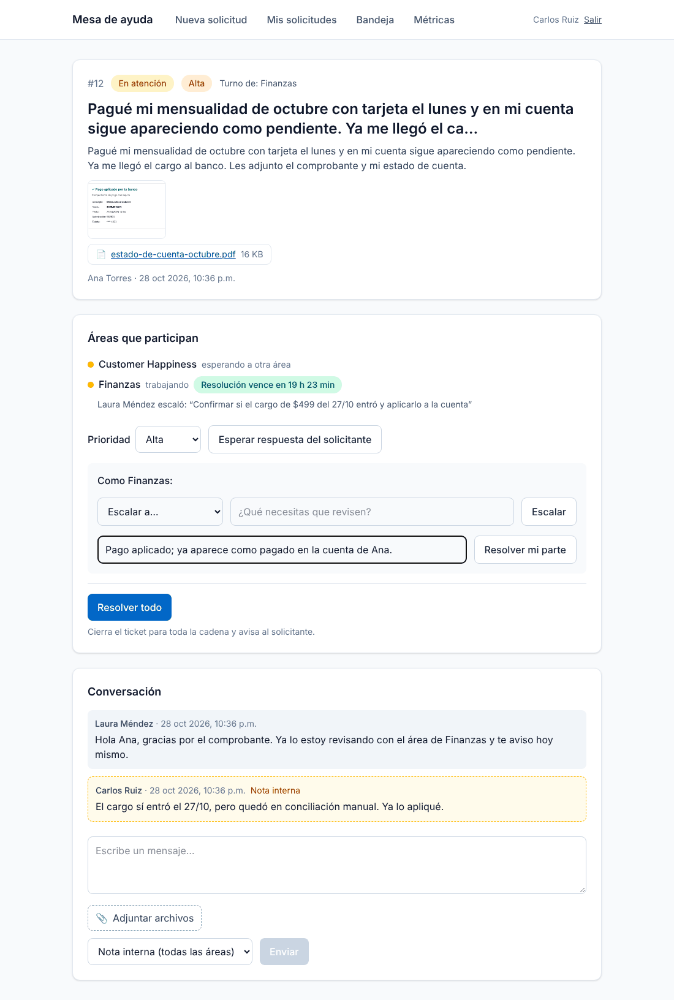

El ticket **regresa a quien lo escaló** (Customer Happiness), con la resolución de Finanzas a la vista. Finanzas queda como "resuelto" y con su SLA medido por separado.

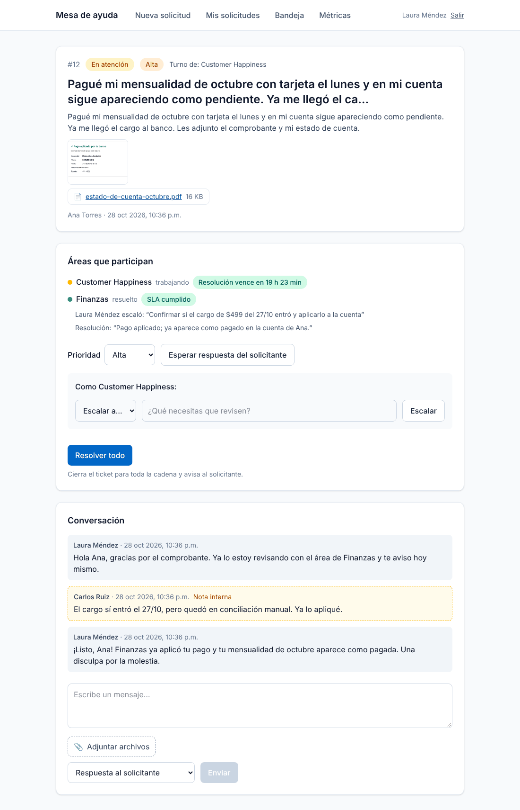

### 6.4 Resolver todo

Laura le avisa a Ana y da clic en **Resolver todo**. Esto cierra el ticket **para toda la cadena** y le avisa al solicitante.

> **¿Cuándo uso cada botón?**
> - **Resolver mi parte**: ya hice lo que me pidieron; que siga el área que me lo pasó.
> - **Resolver todo**: el problema del solicitante ya quedó; se acaba para todos.

### 6.5 Cadenas de más de dos áreas

Una cadena puede ser tan larga como haga falta. En este otro ejemplo, Customer Happiness escaló a TI y TI escaló a Desarrollo. Cada área ve quién escaló, por qué, y su propio semáforo:

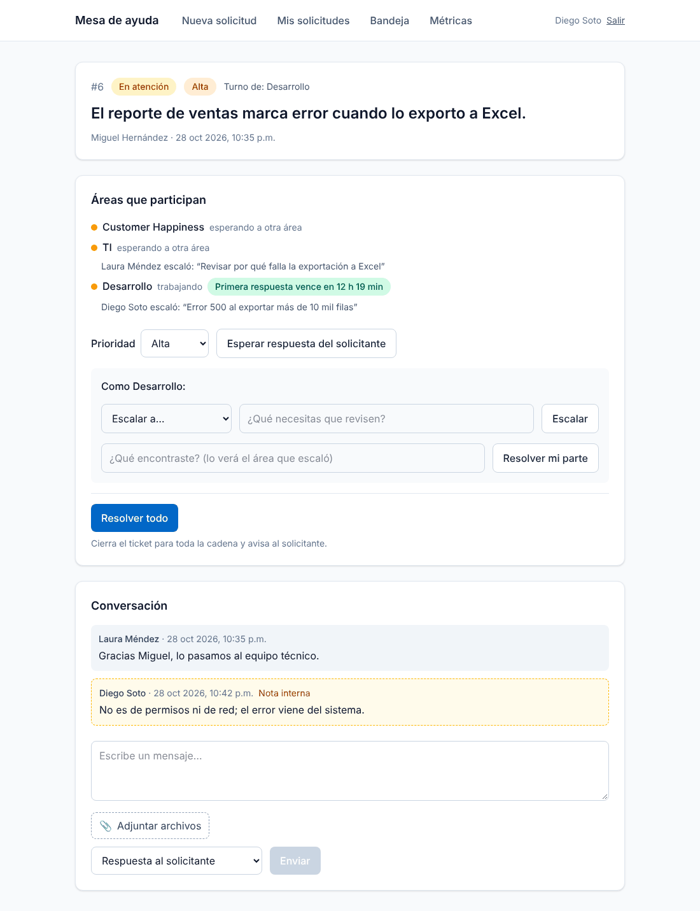

> 💡 **Diferenciador:** en muchas herramientas, pasar un caso a otro equipo significa reasignarlo (y perder quién lo tenía) o crear un ticket nuevo y "vincularlo". Aquí cada área tiene su tramo, su reloj y su resolución dentro del mismo ticket, y al terminar su parte el ticket regresa solo a quien se lo pidió.

---

## 7. Tiempos de atención (SLA) y semáforo

### 7.1 Qué se mide

Cada área que trabaja un ticket tiene dos metas, según la prioridad:

- **Primera respuesta**: cuánto puede tardar en contestar o actuar por primera vez.
- **Resolución**: cuánto puede tardar en resolver su parte.

Tiempos iniciales (en horas hábiles; el administrador los cambia):

| Prioridad | Primera respuesta | Resolución |
| --- | --- | --- |
| Urgente | 30 min | 4 h |
| Alta | 2 h | 9 h |
| Normal | 4 h | 27 h (3 días hábiles) |
| Baja | 9 h | 45 h (5 días hábiles) |

### 7.2 El semáforo

| Color | Significa |
| --- | --- |
| 🟢 Verde: "vence en…" | A tiempo. |
| 🟡 Amarillo: "vence en…" | Por vencer: queda menos de una cuarta parte del tiempo. |
| 🔴 Rojo: "vencida hace…" | Ya se pasó. |
| ⚪ Gris: "SLA en pausa" | El reloj está detenido (esperando al solicitante, o resuelto). |

En esta bandeja de TI se ven un ticket urgente vencido arriba, uno escalado a Desarrollo y uno de prioridad baja a tiempo:

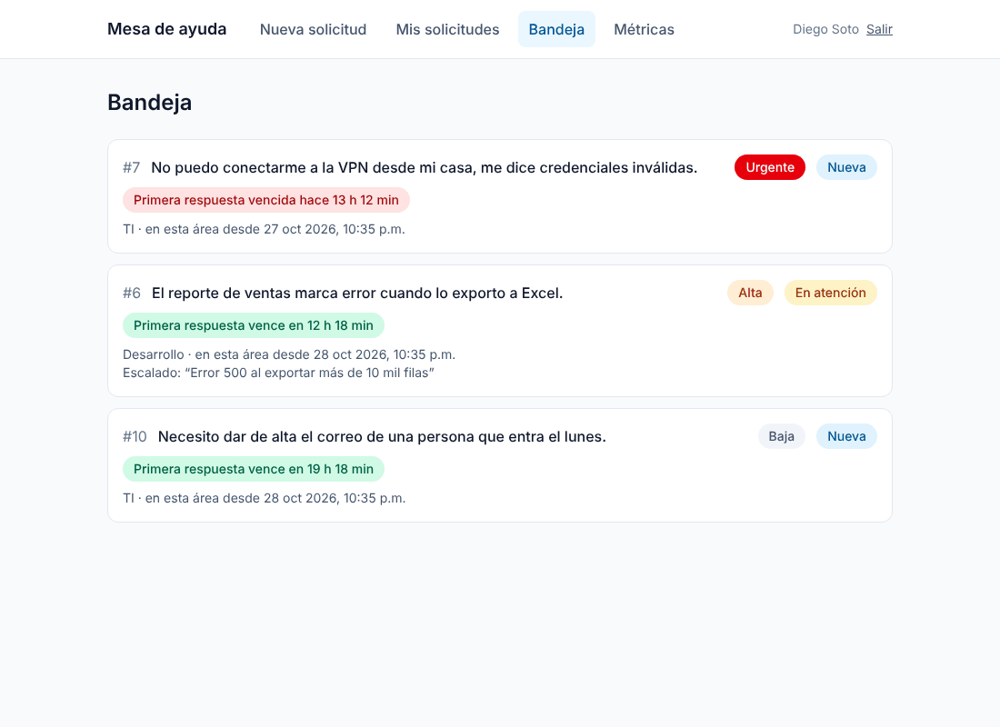

### 7.3 Cuándo corre el reloj

- Solo en **horario laboral** (por defecto lunes a viernes de 9:00 a 18:00, hora de Ciudad de México).
- **No** cuenta en los **días festivos** registrados.
- **Se detiene** mientras se espera respuesta del solicitante y mientras el ticket está resuelto.
- **Para el área que escaló, se detiene** mientras la otra área trabaja. Así nadie "paga" el tiempo de otro.

### 7.4 Configurarlo (administrador)

En **SLA**:

1. **Tiempos por prioridad**: cambia las horas y da clic en **Guardar tiempos**. Con **Tiempos propios para** puedes darle a un área tiempos distintos a los generales.
2. **Horario laboral**: hora de entrada, salida, zona horaria y días laborales.
3. **Días festivos**: agrega la fecha y el nombre (por ejemplo "Día de la Revolución").

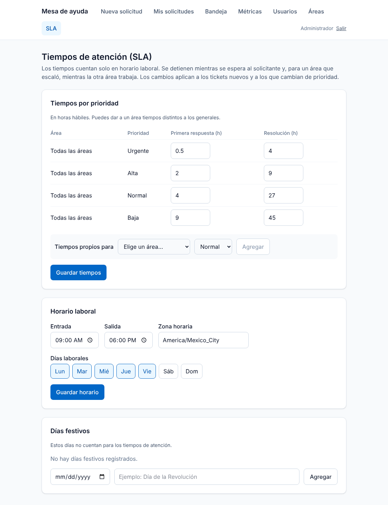

Los cambios aplican a los tramos nuevos y a los tickets que cambian de prioridad; los vencimientos ya calculados se respetan.

---

## 8. Resolver, encuesta y cierre automático

### 8.1 Lo que ve el solicitante al resolverse

Cuando el agente resuelve, el solicitante ve el aviso **"Marcamos tu solicitud como resuelta. ¿Quedó todo bien?"** con dos botones:

- **Sí, ya quedó**: cierra la solicitud.
- **No, sigue pasando**: la reabre y regresa al área.

Debajo aparece la encuesta: **¿Cómo calificas la atención?**, de 1 a 5 estrellas, con un comentario opcional.

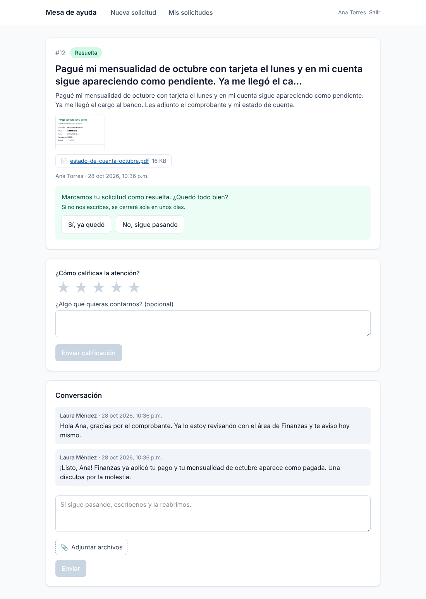

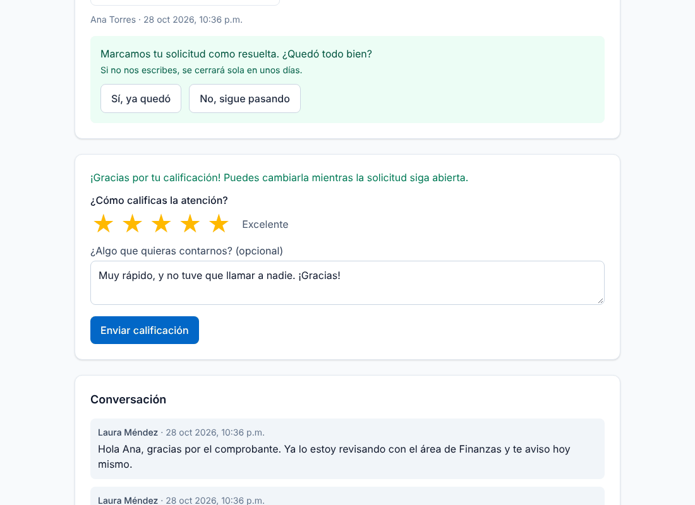

El solicitante puede cambiar su calificación mientras la solicitud siga resuelta.

### 8.2 Lo que ve el agente

El agente ve la **Calificación del solicitante** en el ticket, y un botón **Cerrar ahora** si no quiere esperar el cierre automático.

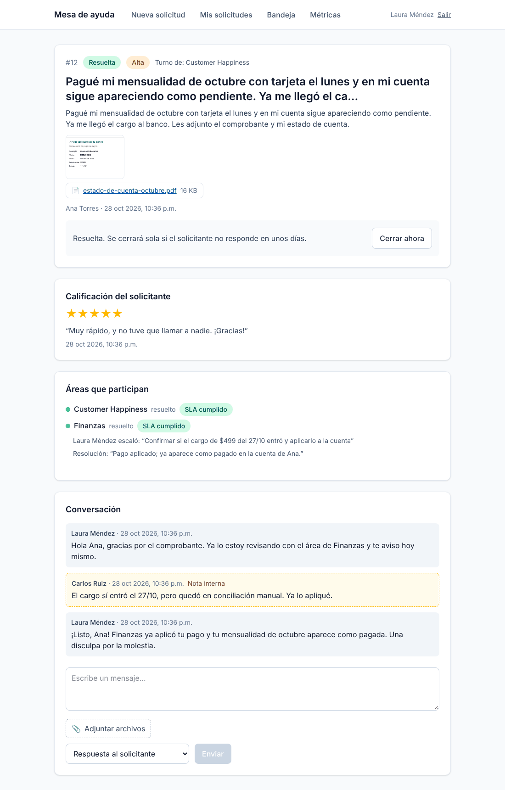

### 8.3 Encuesta desde el correo, sin iniciar sesión

El correo de "Tu solicitud quedó resuelta" trae un enlace para calificar en un clic. Se abre sin pedir contraseña (pensado para quien solo escribe por correo) y vale 30 días.

<p>
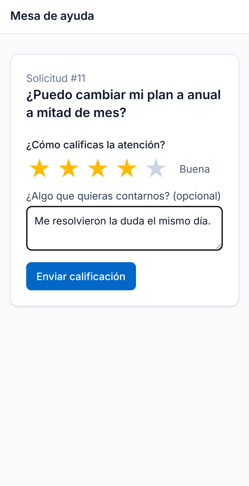
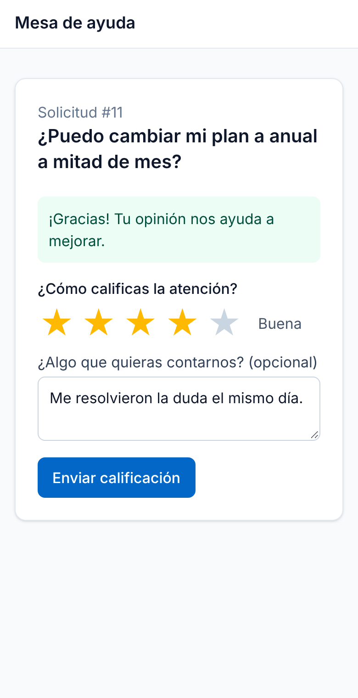
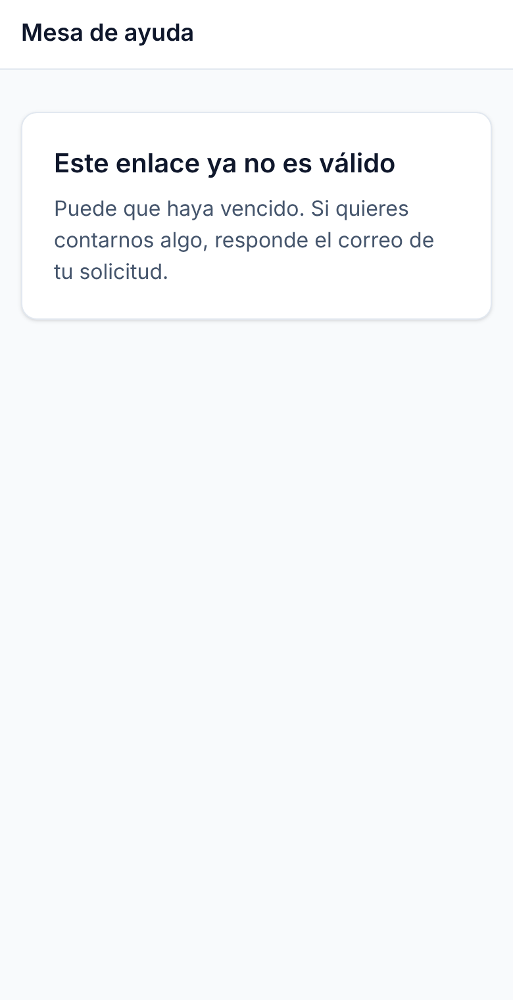
</p>

El enlace solo sirve para calificar *esa* solicitud: no muestra la conversación ni datos de otras personas. Si el enlace ya venció o es inválido, lo dice claramente.

### 8.4 Cierre automático

- Una solicitud **resuelta se cierra sola a los 3 días hábiles** si el solicitante no responde (el administrador lo cambia con `TICKETS_AUTO_CLOSE_DAYS`; 0 lo desactiva).
- Si el solicitante escribe antes, **se reabre**.
- Si alguien responde por correo a una solicitud **ya cerrada**, se abre **una nueva** que menciona la anterior.

---

## 9. Correo electrónico

El correo es opcional, pero cuando está activo la mesa de ayuda funciona incluso para quien nunca entra a la aplicación.

### 9.1 Crear tickets escribiendo al buzón

- Cada correo nuevo al buzón de ayuda (por ejemplo `ayuda@tuempresa.com`) **abre un ticket** en el área configurada, con sus adjuntos.
- Si el asunto trae el folio, como `[#12]`, el correo **se agrega a ese ticket** (sin el texto citado). Si estaba resuelto, se reabre.
- Se ignoran respuestas automáticas ("fuera de la oficina"), correos del propio buzón y duplicados.

### 9.2 Avisos al solicitante

La aplicación manda por correo:

1. **Recibimos tu solicitud**, con el folio.
2. **Respuesta a tu solicitud**, cada vez que un agente le contesta (las notas internas nunca salen).
3. **Tu solicitud quedó resuelta**, con el enlace a la encuesta.

Así se ve el aviso de solicitud resuelta (texto real enviado por la aplicación):

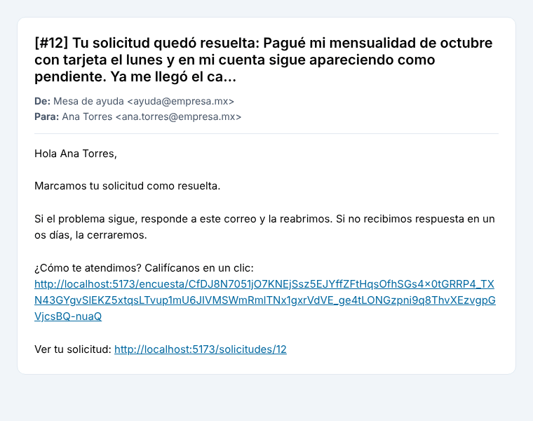

El solicitante puede **contestar el correo** sin cambiar el asunto y su respuesta se agrega a la conversación.

> Los avisos se guardan primero y se envían en segundo plano con reintentos: si el servidor de correo se cae un rato, nadie se queda esperando y los avisos salen cuando regresa.

La configuración (Microsoft 365, IMAP o SMTP) está en el [README](../README.md#correo).

---

## 10. Métricas

En **Métricas**, cada agente ve sus áreas; supervisores y administradores ven todas. Elige el periodo (**últimos 7, 30 o 90 días**) y el área.

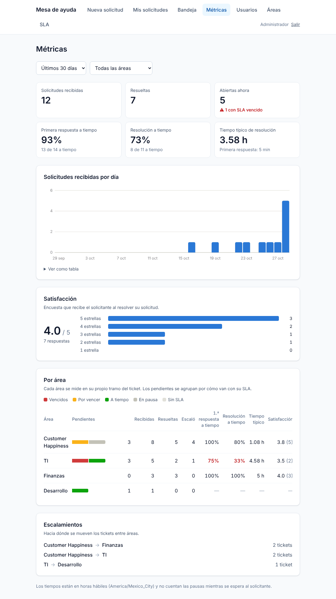

Qué muestra:

- **Solicitudes recibidas, resueltas y abiertas**, y cuántas abiertas tienen el SLA vencido.
- **Primera respuesta a tiempo** y **resolución a tiempo**, en porcentaje y en números ("13 de 14 a tiempo").
- **Tiempo típico de resolución** y de primera respuesta (la mediana, en horas hábiles; no lo distorsiona un caso atípico).
- **Solicitudes recibidas por día**, con opción de **Ver como tabla**.
- **Satisfacción**: calificación promedio y cuántas respuestas hubo de 1 a 5 estrellas.
- **Por área**: pendientes según su semáforo, recibidas, resueltas, cuántas escaló, cumplimiento, tiempo típico y satisfacción.
- **Escalamientos**: hacia dónde se mueven los tickets entre áreas (por ejemplo, "Customer Happiness → Finanzas: 2 tickets").

> 💡 **Diferenciador:** como cada área tiene su propio tramo, la tabla **Por área** dice exactamente quién cumple y quién no. En el ejemplo, TI tiene un 33 % de resolución a tiempo: ahí está el cuello de botella, no en Customer Happiness. Y la sección **Escalamientos** muestra qué áreas dependen más de otras.

---

## 11. Desde el celular

Toda la aplicación se adapta a la pantalla del celular: levantar solicitudes, la bandeja, los tickets, las métricas y la encuesta.

<p>
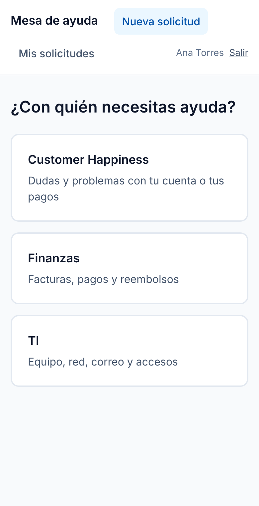
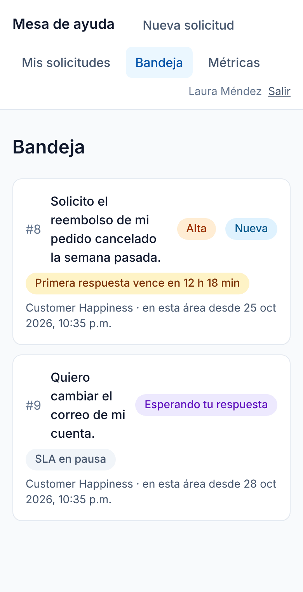
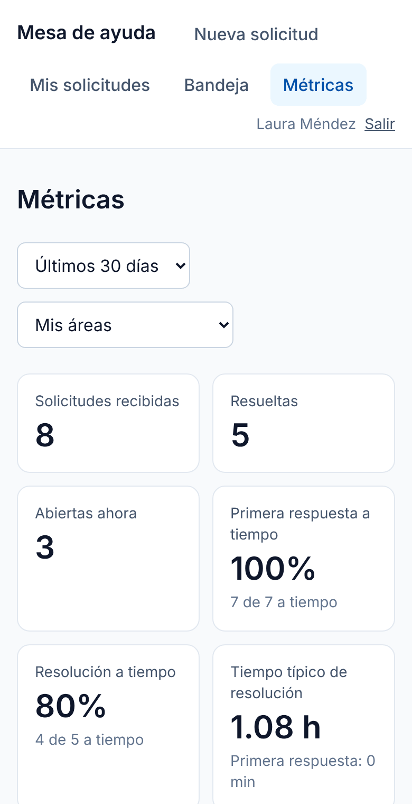
</p>

---

## 12. Guion de prueba en 15 minutos

Para probar todo el recorrido tú solo, usa una ventana normal y una de incógnito (o dos navegadores) para estar con dos personas a la vez.

1. **Como administrador**: crea las áreas *Customer Happiness*, *Finanzas* y *Desarrollo* (esta última sin recibir solicitudes).
2. Crea tres usuarios: un agente de Customer Happiness, uno de Finanzas y un solicitante. Anota sus contraseñas temporales.
3. **Como solicitante** (ventana de incógnito): entra, cambia tu contraseña y levanta una solicitud a Customer Happiness con una captura adjunta.
4. **Como agente de Customer Happiness**: abre la **Bandeja**, entra al ticket, súbele la prioridad a **Alta**, contesta al solicitante y **escala** a Finanzas.
5. **Como agente de Finanzas**: deja una **nota interna**, escribe qué encontraste y da clic en **Resolver mi parte**.
6. **Como agente de Customer Happiness**: confirma que el ticket regresó con la nota de Finanzas y da clic en **Resolver todo**.
7. **Como solicitante**: revisa que *no* ves la nota interna, califica con estrellas y da clic en **Sí, ya quedó**.
8. **Como administrador**: abre **Métricas** y revisa la satisfacción, el cumplimiento por área y el escalamiento Customer Happiness → Finanzas.
9. Extra: en **SLA**, agrega un día festivo y cambia los tiempos de una prioridad solo para Finanzas.

---

## 13. Preguntas frecuentes

**¿El solicitante necesita cuenta?**
Para entrar a la aplicación, sí: la crea un administrador o entra con Microsoft 365. Si el correo está activo, también puede pedir ayuda solo por correo y calificar desde el enlace, sin contraseña.

**¿Qué pasa si escalo al área equivocada?**
La otra área puede escalarlo a donde corresponde o resolver su parte para que regrese contigo.

**¿Por qué el semáforo dice "en pausa"?**
Porque se está esperando al solicitante, el ticket está resuelto o, para tu área, otra área está trabajando su parte.

**¿Se cuentan las noches y los fines de semana?**
No. Solo el horario laboral configurado, sin días festivos.

**¿Qué archivos puedo adjuntar?**
Hasta 5 archivos de máximo 10 MB por solicitud o mensaje. Por seguridad no se aceptan ejecutables ni scripts (`.exe`, `.bat`, `.ps1`, `.js`, `.html`, `.svg`, entre otros). Los archivos de una nota interna solo los ven las áreas.

**Olvidé mi contraseña.**
Pídele a un administrador que te genere una contraseña temporal nueva desde **Usuarios › Editar**.

**¿Puedo cambiar mi calificación?**
Sí, mientras la solicitud siga resuelta. Si se cerró sola antes de que la calificaras, todavía puedes calificarla una vez. Una calificación baja no reabre la solicitud; para eso, escríbenos en la conversación.
